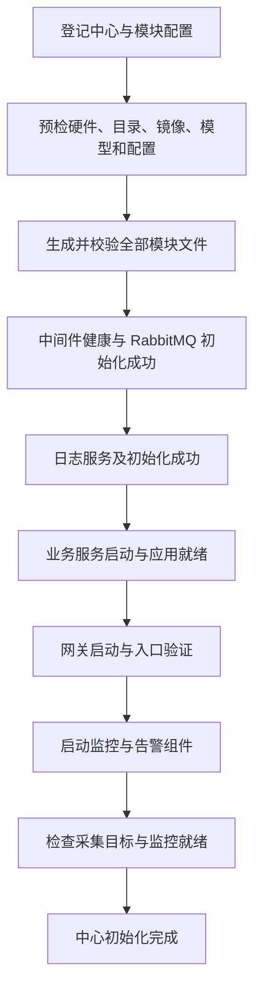

# 中心模块化部署方案

日期：2026-10-11。状态：核心流程已实现，本文保留设计依据；当前操作说明及实现边界以 README“模块化中心部署”为准。

实现采用中心内 `deployment_json` 保存模块状态与依赖，并复用现有任务日志，未引入本稿建议的多张模块表。配置历史保存为目标机备份文件；模板初始化仅补齐缺失文件，不覆盖已有配置。自定义服务的采集目标和路由通过模块文件编辑器配置，不自动推断。

依据：`D:\yl\center-cv-docker` 的 README、五类独立 Compose、两种 GPU 平台配置，以及本项目的初始化、软件发布、模型发布、基础镜像更新、数据库和前端代码。

## 1. 目标与现状

新中心按模块准备配置、检查依赖、初始化并启动服务，业务就绪后自动开启监控。日常软件和模型升级只影响目标服务；每个模块的 Compose 都能单独编辑、校验、部署和回退。新增模块通过登记配置接入，不再修改一套写死的全中心部署逻辑。

当前 Docker 仓库已经具备所需的物理拆分，管理端尚未接入：

| 当前实现 | 影响 | 改造方向 |
| --- | --- | --- |
| `domain.Center`、SQLite 只有 `compose_file/compose_content` | 一个中心只能管理一个入口 | 中心下登记多个模块 |
| `provision.Initialize` 生成和上传完整模板 | “已初始化”只表示文件准备完成 | 分离配置准备、服务启动、就绪和监控状态 |
| `deploy.Run` 对完整文件执行 `up -d --remove-orphans` | 发布作用域包含全部服务 | 模块定位和服务级部署 |
| 纯模型发布调用 `RestartCompose` | 模型变更导致无关组件重启 | 仅应用到模型使用方 |
| 联合发布软件后再次重启整套 Compose | 已重建业务可能再次启动 | 合并受影响服务，单次应用 |
| 基础镜像更新可 `--force-recreate` 整套服务 | 更新基础镜像也扩大停机范围 | 按镜像使用方选择模块和服务 |
| 单个 YAML 编辑器、全套操作按钮 | 无法独立管理分类文件 | 模块列表、模块编辑器和发布计划 |

注意：普通 `up -d` 不等于必然重建所有未变容器。这里能从代码确认的问题是操作范围过大、模型发布全套重启、部分路径强制全套重建；实际耗时还需通过阶段日志测量。

## 2. 模块边界

沿用 Docker 仓库五类入口，每次 Compose 调用只传一个 `-f`，不合并为总 Compose，不使用多文件叠加。

| 模块 ID | 默认项目名 | 模板来源 | 职责 |
| --- | --- | --- | --- |
| `infra` | `center-cv-infra` | `infra/compose.yml` | RabbitMQ、队列初始化 |
| `logging` | `center-cv-logging` | `logging/compose.yml` | Elasticsearch、Kibana、Filebeat、日志初始化 |
| `business` | `center-cv-business` | `business/compose.<platform>.yml` | Worker、Ingress、落格核验、转码 |
| `gateway` | `center-cv-gateway` | `gateway/compose.yml` | Nginx、统一访问入口 |
| `monitoring` | `center-cv-monitoring` | `monitoring/compose.<platform>.yml` | Prometheus、Grafana、采集器、Alertmanager |

`platform` 为 nvidia 或 denglin，只实例化实际平台，保持 runtime、GPU exporter、仪表盘对应关系。保留管理端按实际 GPU 数和 CPU 拓扑渲染 Worker 的能力，不直接照搬 Docker 仓库固定 8 Worker 的 CPU 绑定。

所有模块维持 host 网络和本机固定端口互通。独立项目不隔离 host 端口和固定容器名，同一 Docker Engine 上禁止重复登记并启动冲突部署。

五类是默认模块，不是固定枚举。后续可登记 `recording`、`custom-service` 等独立模块，也可向已有 business Compose 添加服务。

## 3. 目录与配置所有权

```text
~/.local/share/center-manager/
├── deploy/
│   ├── infra/        compose.yml、module.env、rabbitmq/
│   ├── logging/      compose.yml、module.env、filebeat/、kibana/、elasticsearch/
│   ├── business/     compose.yml、module.env
│   ├── gateway/      compose.yml、module.env、nginx/、secrets/
│   ├── monitoring/   compose.yml、module.env、prometheus/、grafana/、alerting/…
│   └── custom-service/ compose.yml、module.env、自定义配置
└── data/
    ├── models/
    ├── logs/
    └── media-resources/
```

平台模板在生成时选定，中心上统一保存为各模块的 `compose.yml`。每个模块有固定 project name、工作目录和可选环境文件。执行器明确指定该模块的项目名和环境文件，排除登录 shell 中 `COMPOSE_PROJECT_NAME`、`COMPOSE_FILE`、`COMPOSE_ENV_FILES`、`COMPOSE_REMOVE_ORPHANS` 等隐式覆盖；禁止给全部模块使用同一个项目名。

中心显式保存 `workspace_root`、`deploy_root`、`models_root`、`logs_root`、`media_resources_root`。不能继续从某个模块 Compose 路径推导数据目录，否则 `deploy/business/compose.yml` 会被旧路径函数错误推导为业务目录下的 data。已有中心迁移时保留原来的绝对数据路径。

配置规则：

- 模板只提供初始默认值；中心配置可以单独修改，普通初始化和软件发布均不覆盖用户修改。
- Compose、环境变量、挂载配置文件分别管理。编辑 Compose 不自动重建；单独提供“保存”和“部署已保存配置”。
- 保存前校验 YAML 和目标机 `docker compose config`，展示差异，使用 revision 防止覆盖他人编辑；失败不替换生效文件。
- 远端实际文件 hash 与上次记录不同，标记“远端配置已变更”，允许读取并导入，不静默覆盖。
- 受管普通文件保存历史版本；密钥单独加密管理、输出脱敏，不进入普通明文快照和任务日志。
- Compose 中的 `name` 与登记项目名必须一致；已部署模块的项目名或路径变更走迁移计划，不能作为普通文本编辑直接生效。
- 模板升级提供每个文件的差异预览；仅更新选中文件。保留用户改动，冲突交由编辑解决，不全中心强制重新生成。
- 发布修改原始 YAML 的目标镜像和版本标签；`compose config` 展开结果仅用于校验、识别依赖和比较，不回写替代原始配置，避免固化变量和丢失锚点、注释。

## 4. 新中心初始化流程

界面可按网关、中间件、日志、监控、业务分类展示；实际启动按依赖顺序，监控放最后。



1. **预检与准备**：检查 SSH、Docker、Compose 所需能力、GPU runtime、磁盘和目录权限；检查已有容器名、端口和挂载冲突。同步缺少的镜像、模型及配置，预先校验所有模块。业务 `pull_policy: never` 的镜像必须已经存在。
2. **中间件**：等待 RabbitMQ healthy，再显式运行幂等的 `rabbitmq-init`，退出码为 0 才放行业务。容器存在或曾经退出不能视为本次初始化成功。
3. **日志**：等待 Elasticsearch、Kibana 健康；记录 `elasticsearch-init`、`kibana-init` 成功退出；检查 Filebeat 运行及采集。一次性任务成功退出是正常状态。
4. **业务**：确认已选择兼容模型；启动业务模块，随后检查 Worker `/api/readyz`、Ingress `:8090/readyz`、落格核验 `:8091/readyz` 和转码 `:8092/readyz`。这些路径来自现有监控配置。不能仅凭 Compose 的端口健康检查判定应用就绪。
5. **网关**：先检查 Nginx 配置，启动后验证实际入口；不使用会创建真实任务的请求作为健康检查。
6. **监控**：前序必选模块成功后自动启动 monitoring；按当前启用服务生成采集目标，检查 Prometheus、Grafana、采集器和告警配置。Prometheus 配置有 `/prometheus` route prefix，探测路径须与实际配置一致，不能直接照搬裸根路径。
7. **完成**：全部必选模块就绪且监控验证通过后，才记录中心初始化完成；显示每个模块的独立结果。

没有模型或业务镜像时停在“等待业务发布”，保留已成功的基础模块，监控尚未开启，不错误标记为完整初始化成功。后续联合发布准备好业务后，继续网关和监控阶段。

默认五类均启用。允许显式跳过可选日志/监控，但状态必须显示“未启用”，同步移除相应采集目标并说明对应网关页面不可用。未配置飞书时允许显式关闭通知；不能伪造 Webhook 或把通知未配置当成已验证成功。

### 状态、恢复与依赖

中心状态建议：`draft → preparing → initializing → waiting_business / starting → ready`，失败为 `failed`，已运行但部分异常为 `degraded`。

模块状态建议：`pending / prepared / starting / healthy / failed / stopped / disabled`，独立记录配置 revision、实际应用 revision、错误和最近检查时间。整体阶段与模块状态分开，不能仅用一个 `initialized_at` 代替。

持久化每个步骤的输入版本、起止时间、退出码和产物 hash。失败时停止依赖它的后续步骤，保留已运行模块；重试先验证实际状态，仅重做未完成或输入变更的步骤。管理端重启后的进行中任务标记为中断，重新核对现场后恢复，不盲目重放。

跨模块依赖由管理端执行器等待，不能写成跨文件 `depends_on`。区分持续依赖（business 需要 infra）与首次启动屏障（首次 monitoring 等待业务和网关）；日常业务失败时监控必须继续运行以便告警。

## 5. 日常更新的最小作用域

| 操作 | 配置与执行范围 | 不应连带执行 |
| --- | --- | --- |
| 更新 Worker 代码 | business 中映射到该源码的 Worker | 中间件初始化、网关、日志、监控重启 |
| 更新 Ingress/转码/落格核验 | business 中对应服务 | 其他业务容器重建 |
| 仅升级模型 | 模型文件及使用这些模型的 Worker | 整套 Compose 重启 |
| 软件和模型联合升级 | 先准备两类产物，再统一应用受影响服务 | 软件更新后再次重启全中心 |
| 修改 Nginx 配置 | gateway 中 nginx | 业务重建 |
| 修改采集或仪表盘 | monitoring 中相关服务 | 业务重建 |
| 更新基础镜像 | 默认仅加载；应用时选择实际使用方 | 全中心 force-recreate |
| 新增独立模块 | 新模块及明确需要修改的路由/采集配置 | 重新生成所有模块 |

软件发布计划的目标键为 `(center_id, module_id, service_name)`，不能只按 service name 匹配。镜像仓库映射保留现有标签机制并扩展到模块；读取容器时同时过滤 Compose project 标签。映射有歧义时返回冲突，不凭名字猜测。

服务级部署仅在依赖已就绪时使用 `up -d --no-deps <services>`；完整模块首次启动允许处理组内依赖。普通更新不默认加 `--force-recreate`；同标签镜像内容变化、挂载配置更新需重建时，限定到已计算的目标服务。禁用 `--remove-orphans`，删除服务通过独立差异计划精确停止和移除已确认归属的容器，保留数据卷。

模型保持现有不可变 Manifest、校验和原子入口切换能力，不强迫每次模型升级都改 YAML。模块登记模型使用方：默认是业务 Worker，自定义服务可显式声明。模型切换后默认只重启使用方；只有服务明确提供并验证了热加载协议时才能使用热加载。无法精确识别时，可重启已登记的全部 Worker，但不能退化成重启全中心。

联合发布先完成镜像构建、模型下载和完整校验，再进入应用阶段。新镜像导致重建的 Worker 已加载新模型，无需再重启；未重建但模型变更的 Worker 单独重启一次。准备失败不得提前激活模型。

每次应用后检查目标服务就绪；失败保留现场、记录部分成功，不把任务写成成功。保存旧 Compose、镜像引用、模型指针以生成明确的回退计划；配置/镜像回退不等于数据或队列的事务回滚。

保留中心级互斥锁作为首版策略，锁覆盖联合发布的整个准备/应用边界，内部步骤不得重复获取同一把非重入锁。拆分 Compose 的性能收益首先来自缩小操作范围，无需首版就引入模块间并发写入。

现有 host 网络和固定端口下，不承诺零停机或滚动更新；业务重建前按实际能力停止接收新任务并排空在途任务，不虚构未提供的排空接口。

## 6. 配置模型与扩展接口

建议新增数据表：

| 表 | 核心字段 |
| --- | --- |
| `center_modules` | id、center_id、key、display_name、project_name、compose_path、enabled、platform、template_version、revision、applied_revision、status |
| `module_dependencies` | module_id、depends_on_module_id、condition、scope（持续依赖/首次启动） |
| `module_files` | module_id、relative_path、kind、content/加密引用、hash、revision、managed |
| `module_revisions` | module_id、revision、配置快照、创建时间、操作来源 |
| `module_release_bindings` | module_id、service_name、source_id/镜像仓库、模型使用方声明 |
| `initialization_steps` | task_id、module_id、step、输入 revision、status、开始/结束时间、错误 |

文件内容按类型设定大小限制，路径必须限制在模块工作目录内并检查符号链接越界。自定义模块可配置 Compose、环境文件、挂载文件、依赖、超时、HTTP/TCP/容器健康检查和一次性初始化服务。首版不需要开放额外的任意远程 Shell 步骤。

`(center_id, key)`、模块路径和项目名需校验唯一性；依赖图禁止循环，禁用被启用模块依赖的模块应报出具体依赖。依赖变更必须进入操作计划，不自动重启所有下游。

建议 API（均为待实现）：

```text
GET/POST       /centers/:id/modules
GET/PUT/DELETE /centers/:id/modules/:moduleID
GET/PUT        /centers/:id/modules/:moduleID/compose
GET/PUT        /centers/:id/modules/:moduleID/files/*path
POST           /centers/:id/modules/:moduleID/validate
POST           /centers/:id/modules/:moduleID/plan
POST           /centers/:id/modules/:moduleID/actions
GET            /centers/:id/modules/:moduleID/revisions
POST           /centers/:id/initialize/plan
POST           /centers/:id/initialize
POST           /centers/:id/initialize/resume
```

沿用 `/api/v1` 前缀和现有任务/SSE 机制。计划返回 module、service、旧/新版本、配置差异、依赖、预计重启范围和预检错误；执行绑定计划 revision，配置漂移时要求重新生成计划。DELETE 只删除未部署且无依赖的登记；运行中模块先走明确的停止/卸载流程，卸载默认保留数据。

## 7. 界面变化

新建中心以“连接信息 → 硬件与目录 → 模块配置 → 镜像/模型 → 初始化计划”为流程，五类模块预置，也可添加自定义模块。初始化页展示阶段进度、失败原因和“从失败步骤继续”。

中心运行详情增加模块表：名称、项目名、Compose 路径、状态、已保存/已应用版本、最近任务。每行提供编辑配置、校验、查看差异、部署、重启、停止和历史版本。沿用 YAML 编辑器，通过模块切换读取相应文件。

版本发布页面明确列出受影响模块和服务，默认只选目标业务；基础镜像更新页面取消默认全套重建概念，改为加载后选择使用方。原有中心级操作移到明确的全中心维护入口，普通部署不调用“删除中心全部容器”。

## 8. 旧中心兼容与迁移

现有中心先登记为一个 `legacy` 模块，保留实际 Compose 路径、项目名、数据目录和现有配置。不能仅根据是否存在 `initialized_at` 判断已经完成五模块迁移。

迁移分成只读计划和维护窗口执行：

1. 读取实际容器的 project/service 标签、挂载、端口、镜像版本、现有 Compose 和模型状态；识别用户新增服务，未分类服务不得丢失。
2. 生成五模块候选配置，保留当前镜像版本、环境变量和业务数据路径；对旧命名卷使用确切 `name` 和 `external: true` 复用，避免切到空卷。
3. 校验配置、所有权、健康检查和回退材料，展示需重建的容器清单。
4. 暂停接入并按现场要求排空任务；精确停止和移除旧项目所属容器，不删卷、不执行全主机容器清理。
5. 按新初始化顺序创建各独立项目，确认 RabbitMQ、模型、业务、日志和历史监控数据，再切换登记状态。
6. 失败保留迁移检查点和旧配置；回退同样先处理新项目容器名称占用，再恢复旧项目，不能同时运行两套固定名称容器。

仅改变项目名不能改变已有容器标签，因此迁移需要一次受控重建。后续日常业务发布才获得模块隔离收益。禁止以 `--remove-orphans` 或 `down -v` 实现迁移。

## 9. 代码实施顺序

1. **模块注册与兼容层**：`internal/domain`、`internal/store`、`internal/center` 增加模块模型和迁移；`internal/centerpath` 改为显式中心目录。现有中心自动登记 legacy，业务行为先保持兼容。
2. **模板包与执行器**：`internal/templates` 接入 Docker 仓库分类入口与新目录，新增统一模块执行器；固定模板版本并记录来源 commit，构建镜像时复制到 `/app/templates`，运行时从文件系统读取，不依赖开发机的 `D:` 路径。模板导入和渲染验证覆盖两个平台。
3. **模块配置 API/UI**：`internal/provision` 拆出文件准备和配置保存；`internal/api`、`web/src/types.ts`、`web/src/App.vue` 接入模块列表与编辑器。先形成可独立编辑部署的闭环。
4. **最小发布范围**：`internal/deploy`、`internal/modelasset`、`internal/api/server.go`、`internal/baseimage`、`internal/centeraction` 统一通过模块执行器应用计划，去掉日常流程的全套重启和全套强制重建。
5. **初始化状态机**：补齐服务就绪、一次性任务、业务等待和监控最后启动；接入步骤日志和恢复。
6. **迁移与回退**：旧中心迁移预检、持久卷映射、精确容器清单、维护窗口执行和回退计划。

## 10. 验收标准

- NVIDIA、登临分别生成五类合法 Compose，且路径、GPU/CPU 绑定、监控目标一致。
- 全新中心可以从配置准备走到业务就绪、监控启动；任一步失败不误报完成。
- RabbitMQ 或日志初始化任务失败时，任务日志包含模块、步骤和退出码，并阻止应被阻止的下游。
- 修改业务镜像后，无关四个模块的容器 ID、StartedAt 保持不变；业务模块内未选中服务也保持不变。
- 纯模型升级只重启已登记的模型使用方；联合升级中每个受影响 Worker 最多应用一次。
- 新增第六个模块不需要修改后端模块枚举，可完成编辑、校验、启动和就绪检查。
- 手工修改远端文件可被检测；保存冲突返回明确错误；SSH 修改配置文件后，详情页检测指纹变化，重新发布后生效；采用新内置模板需重置并重新初始化。
- 配置保存不自动启动服务；部署失败不覆盖成功状态、不删除数据卷。
- 旧中心迁移保留实际卷和模型目录；无关项目容器不受影响；固定容器名冲突在执行前暴露。
- 管理端重启、任务取消、重复点击、初始化重试和并发编辑均有可恢复且不越界的行为。

验证分为 Go 单元/集成测试、前端类型检查和构建、两个平台的 Compose 静态校验，以及隔离测试机上的容器 ID/StartedAt 和失败恢复验证。不得为验证本方案而重建生产容器。
